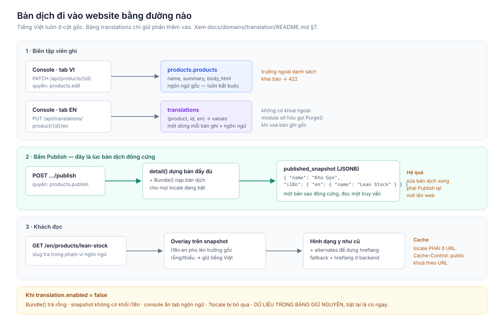

# Domain: Dịch nội dung (translation)

Bản dịch của nội dung do người dùng nhập — tên sản phẩm, tiêu đề bài viết, tiểu
sử thành viên. Đọc file này trước khi viết migration hoặc code.

- Hợp đồng HTTP: [docs/apis/translation-api.md](../../apis/translation-api.md)
- Kế hoạch thi công: [implementation.md](implementation.md)
- Nguồn dữ liệu sản phẩm: [docs/domains/products/README.md](../products/README.md)
- Bối cảnh kinh doanh: [OVERVIEW.md](../../../OVERVIEW.md)

---

## 0. Sơ đồ

**Đường đi của bản dịch** — ghi ở đâu, đông cứng lúc nào, khách đọc ra sao, và
chuyện gì xảy ra khi tắt module:



---

## 1. Phạm vi

**Trong phạm vi:** bản dịch của dữ liệu nằm trong database và do người dùng nhập.

**Ngoài phạm vi:** chữ nằm trong mã nguồn — nhãn nút, tiêu đề cột, thông báo lỗi.
Những thứ đó là i18next, sống ở `src/console/src/locales/*.json`, và không đi qua
module này. Hai bài toán trùng tên nhưng khác hẳn nhau: một bên lập trình viên
viết lúc code, một bên biên tập viên viết lúc vận hành.

Tiếng Việt là **ngôn ngữ gốc**. Nó luôn nằm ở cột gốc của bảng gốc và luôn bắt
buộc. Module này chỉ giữ phần thêm vào.

## 2. Ý tưởng trung tâm: tách đường ghi khỏi đường đọc

Hệ thống đã có sẵn một read model vật chất hoá mà không gọi tên: cột
`published_snapshot`. Mỗi lần bấm Publish, backend đóng băng một bản JSON đầy đủ
và API công khai đọc thẳng từ đó.

Module này **không chồng thêm một tầng lên luồng hiện tại**. Nó kéo cái read model
ấy ra khỏi bảng nội dung và cho nó **một dòng cho mỗi ngôn ngữ**.

```
GHI (console)                        ĐỌC (website)
─────────────                        ─────────────
cms_articles      ─┐                 published_docs
  tiếng Việt       │   Publish        (article, vi, slug) → body
                   ├──────────────▶   (article, en, slug) → body
translations      ─┘                 một dòng = một URL
  tiếng Anh
```

Hai mặt có hình dạng rất khác nhau, nên cho chúng hai bảng khác nhau:

| | Đường ghi | Đường đọc |
| --- | --- | --- |
| Ai dùng | biên tập viên | khách vãng lai |
| Lưu lượng | thấp | cao |
| Cần fallback? | không — phải hiện rõ chỗ trống | không — đã giải quyết lúc publish |
| Hình dạng | từng trường rời, JSONB | một bản ghi hoàn chỉnh |

**Fallback xảy ra một lần lúc Publish, không phải mỗi lượt xem.** Bài viết tiếng
Anh chưa dịch `excerpt` thì ngay lúc publish đã ghi thẳng `excerpt` tiếng Việt vào
dòng `locale='en'`. Đường đọc vì thế là một `SELECT` thuần: không overlay, không
JSONB lồng nhau, không rẽ nhánh.

### Vì sao không nhân dòng trong chính bảng nội dung

Cách phổ biến nhất trong ngành là nhân dòng: mỗi ngôn ngữ một dòng trong
`cms_articles`, nối nhau bằng một `document_id` chung — đây là cách
[Strapi v5](https://docs.strapi.io/cms/api/document-service/locale) làm.

Đã **loại**, vì chính repo của Strapi ghi lại đầy đủ hậu quả:

| Lỗi | Nội dung |
| --- | --- |
| [#12799](https://github.com/strapi/strapi/issues/12799) | API **không fallback**: hỏi ngôn ngữ chưa dịch trả về rỗng, không trả bản gốc |
| [#18942](https://github.com/strapi/strapi/issues/18942) | "Điền từ ngôn ngữ khác" **làm mất** các trường dùng chung (ảnh, giá) |
| [#24780](https://github.com/strapi/strapi/issues/24780) | Chỉ cần một trường dùng chung: sửa bản EN làm mọi ngôn ngữ bị đánh dấu "đã sửa", và publish một ngôn ngữ **publish luôn tất cả** |
| [#25802](https://github.com/strapi/strapi/issues/25802) | Component ghi đè dữ liệu xuyên ngôn ngữ lúc publish |
| [#19798](https://github.com/strapi/strapi/issues/19798) | Nhân bản bài viết ở ngôn ngữ phụ tạo trạng thái sai |

Cùng **một gốc**: nhân dòng buộc phải trả lời "trường nào dùng chung, trường nào
riêng theo ngôn ngữ", và mọi trường dùng chung trở thành bài toán đồng bộ vĩnh
viễn. Giá sản phẩm, ảnh bìa, danh mục, trạng thái publish — nhân ra là sai.

Tách đọc/ghi không có bài toán đó: bảng nội dung **chỉ có một dòng**, nên không có
gì để đồng bộ. Việc nhân bản chỉ xảy ra ở đường đọc, nơi dữ liệu vốn đã là bản sao
đông cứng.

### Vì sao không phải bảng vệ tinh có cột thật

[Payload](https://payloadcms.com/docs/database/postgres) dùng `<bảng>_locales`,
[Directus](https://directus.io/docs/guides/content/translations) dùng
`<bảng>_translations` — cột thật, kiểu thật, index thật.

Hấp dẫn, nhưng thành **7 bảng mới** và mỗi lần thêm một trường dịch được là một
migration. Và chính cộng đồng Directus
[đang mắc](https://community.directus.io/t/best-practice-for-displaying-translated-titles-in-directus-collections/749)
ở chỗ màn danh sách không hiện được tiêu đề đã dịch, phải thêm cột đồng bộ bằng
hook — đúng vấn đề mà đường đọc riêng ở đây giải quyết sạch.

## 3. Hai bảng

### 3.1 `published_docs` — đường đọc công khai

**Một dòng là một URL.** Đây là bảng duy nhất mà website công khai đọc.

```sql
CREATE TABLE published_docs (
    entity       TEXT        NOT NULL,   -- 'product' | 'article' | 'page' | ...
    locale       TEXT        NOT NULL,   -- 'vi' | 'en'
    slug         TEXT        NOT NULL,
    entity_id    UUID        NOT NULL,
    is_current   BOOLEAN     NOT NULL DEFAULT true,
    search_text  TEXT        NOT NULL DEFAULT '',
    body         JSONB,                  -- NULL với dòng chuyển hướng
    published_at TIMESTAMPTZ NOT NULL DEFAULT now(),
    PRIMARY KEY (entity, locale, slug)
);

-- Mỗi nội dung × ngôn ngữ chỉ được có ĐÚNG MỘT URL đang sống.
CREATE UNIQUE INDEX idx_pubdocs_one_live
    ON published_docs (entity, entity_id, locale) WHERE is_current;

CREATE INDEX idx_pubdocs_search
    ON published_docs USING gin (search_text gin_trgm_ops);
```

Khoá chính **chính là URL**. Nhờ vậy mọi lượt xem trang là một lần tra khoá chính,
không join, không rẽ nhánh theo loại nội dung.

Ba cột đáng giải thích:

- **`is_current`** — slug cũ không bị xoá, nó ở lại làm dòng chuyển hướng với
  `body = NULL`. Tra trúng dòng đó → tìm dòng `is_current` của cùng `entity_id` →
  trả `301`. Lịch sử slug vì thế **không cần bảng riêng**; nó là hệ quả của việc
  đặt khoá chính lên URL.
- **`search_text`** — tiêu đề + mô tả, đã phẳng, chỉ để đánh index. Một index GIN
  duy nhất phủ **mọi loại nội dung × mọi ngôn ngữ**. Không có nó thì tìm kiếm là
  seq scan trên JSONB (§8).
- **`body`** — đúng cái `published_snapshot` hôm nay, không đổi hình dạng, chỉ
  chuyển chỗ ở.

### 3.2 `translations` — bên soạn thảo

```sql
CREATE TABLE translations (
    entity     TEXT        NOT NULL,
    entity_id  UUID        NOT NULL,
    locale     TEXT        NOT NULL,
    values     JSONB       NOT NULL DEFAULT '{}',
    updated_at TIMESTAMPTZ NOT NULL DEFAULT now(),
    PRIMARY KEY (entity, entity_id, locale)
);
```

**Một dòng cho mỗi bản ghi × mỗi ngôn ngữ**, không phải mỗi trường một dòng.

Một sản phẩm có khoảng tám trường dịch được. Kiểu field-per-row sẽ thành tám dòng,
và đọc một sản phẩm phải gom tám dòng rồi pivot; đọc một trang danh sách 20 sản
phẩm thành 160 dòng. Một dòng JSONB đọc một phát.

Bảng này **không nằm trên đường nóng của website** — chỉ console đọc nó. Vì vậy
JSONB linh hoạt ở đây là đúng chỗ: thêm trường dịch được không cần migration.

`entity` là động nên **không có khoá ngoại** ở cả hai bảng — xem §9 về dọn rác.

### 3.3 Bỏ cột `published_snapshot`

Bốn bảng đang giữ snapshot trong chính dòng nội dung:

```
products.published_snapshot
cms_articles.published_snapshot
cms_pages.published_snapshot
cms_landing_pages.published_snapshot
```

Cả bốn **chuyển sang `published_docs`** dòng `locale = 'vi'`. Đo trên 50.000 sản
phẩm: bảng nội dung teo từ **55,9 MB xuống 4,4 MB** — snapshot chiếm 92% dung
lượng bảng mà không bao giờ được đọc trong các truy vấn quản trị.

Đây cũng là lời giải cho nỗi lo TOAST: snapshot rời khỏi dòng nội dung thì thêm
bao nhiêu ngôn ngữ cũng không làm phình bảng gốc.

### 3.4 Cột `slug` ở bảng nội dung GIỮ NGUYÊN

Không bảng nào bị xoá cột `slug`.

Có cân nhắc một module slug riêng — bỏ `slug` khỏi cả 7 bảng và cho nó một bảng
định danh URL. Đã **loại vì chi phí**:

```
File Go chạm tới  slug                : 95
File Go chạm tới  published_snapshot  :  9
```

Cùng một tập vấn đề, nhưng một bên đụng 95 file và 7 migration không rollback
được, bên kia đụng 9 file và 4 cột. `published_docs` giải quyết được cả bài toán
URL duy nhất lẫn URL đa ngôn ngữ mà không cần chạm vào đường slug ở bảng nội dung.

Slug ở bảng nội dung giữ vai trò cũ: **slug nháp tiếng Việt**, dùng cho preview và
cho việc đặt chỗ trước khi publish.

## 4. Thực thể và trường dịch được

Khai báo tập trung trong module. Thêm một thực thể là thêm một dòng vào bảng khai
báo trong code, **không cần migration**.

| entity             | trường dịch được                            |
| ------------------ | ------------------------------------------- |
| `product`          | `slug`, `name`, `summary`, `body_html`, `highlights`, `seo` |
| `product_category` | `slug`, `name`, `description`, `seo`        |
| `member`           | `role`, `bio`                               |
| `article`          | `slug`, `title`, `excerpt`, `body_html`, `seo` |
| `page`             | `slug`, `title`, `seo`                      |
| `cms_category`     | `slug`, `name`, `description`, `seo`        |
| `tag`              | `slug`, `name`                              |

Ghi vào một trường không có trong khai báo sẽ bị từ chối với `422`. Danh sách này
là **hợp đồng, không phải gợi ý**: nó chặn việc một bản dịch lặng lẽ ghi đè lên
trường mà không ai định cho dịch — `status`, `sort_order`, giá, ngày.

Khai báo cũng nói **trường nào góp vào `search_text`** (thường là tiêu đề và mô tả
ngắn), để publish biết dựng cột ấy.

### Trường nào KHÔNG dịch, và vì sao

- `status`, `lifecycle`, `sort_order`, ngày tháng — không phải chữ, là trạng thái.
- Quan hệ (chuyên mục, thẻ, thành viên) — dịch ở chính bản ghi được trỏ tới, chứ
  không dịch lại ở nơi trỏ.
- `id`, `created_at` — khoá và dấu thời gian.

`slug` **có** dịch được. Xem §5 — nó là trường đặc biệt nhất của module này.

## 5. Slug — trường đặc biệt nhất

### Google nói gì

Nguồn: [Managing Multi-Regional and Multilingual Sites](https://developers.google.com/search/docs/specialty/international/managing-multi-regional-sites)
và [Localized Versions of your Pages](https://developers.google.com/search/docs/specialty/international/localized-versions).

| Điều | Google nói |
| --- | --- |
| URL có quyết định ngôn ngữ của trang không? | **Không.** *"We don't use any code-level language information such as lang attributes, or the URL."* |
| Dùng từ bản địa trong URL được không? | Được. *"It's fine to use localized words in the URL."* Mã hoá UTF-8. |
| Mỗi bản ngôn ngữ có cần URL riêng không? | **Có.** `hreflang` trỏ tới từng `href` cụ thể; mỗi bản phải có URL của riêng nó. |
| Dùng query param để chọn ngôn ngữ? | **Không khuyến nghị** — `site.com?loc=de` bị đánh dấu *"Not recommended"*. |

Nghĩa là: **dịch slug KHÔNG giúp Google nhận ra ngôn ngữ**. Việc đó do `hreflang`,
`<html lang>` và chính nội dung làm.

### Vậy vì sao vẫn dịch

Vì **người đọc**, và lợi ích SEO đến gián tiếp qua họ:

- URL hiện nguyên văn trong kết quả tìm kiếm. `/en/products/lean-stock` đọc được
  với khách Anh; `/en/products/kho-gon` thì không.
- Link được copy-paste, nhắn qua chat, đọc to trong cuộc họp.
- Từ khoá trong URL là tín hiệu yếu nhưng khác không, và nó nằm trong snippet.

Đây là lý do đủ mạnh. Nhưng nó là lý do **trải nghiệm**, không phải *"Google bắt
buộc"*.

### Ràng buộc duy nhất — và một bug có sẵn mà nó vá

Khoá chính `(entity, locale, slug)` làm việc này **về mặt cấu trúc**: trong một
loại nội dung, một ngôn ngữ, một slug chỉ thuộc về một bản ghi. Không thể khác.

Điều này vá một lỗi đang tồn tại. `cms_pages` ràng buộc
`UNIQUE (parent_id, slug)` — duy nhất **trong cùng cha**, không duy nhất trên URL.
Nhưng truy vấn công khai lại phẳng:

```sql
-- internal/modules/cms/pages/repository.go
FROM cms_pages WHERE slug = $1 AND status = 'published'
ORDER BY parent_id NULLS FIRST LIMIT 1
```

Đã kiểm chứng trên hệ thống chạy thật: tạo được một trang gốc mang slug mà một
trang con đã dùng (`201 Created`). Hai trang cùng publish → `LIMIT 1` → **một
trang vĩnh viễn không ai truy cập được**, không lỗi, không cảnh báo.

Với `published_docs`, trang thứ hai **không publish được** — xung đột khoá chính,
báo `409` ngay cho người dùng.

Đánh đổi đã biết: lỗi hiện ra **lúc publish**, không phải lúc lưu nháp. Người dùng
gõ xong mới biết trùng. Chấp nhận, vì phương án bắt sớm hơn tốn 95 file (§3.4).

### Chưa dịch slug thì URL tiếng Anh là gì

**Vẫn tồn tại, dùng slug gốc:** `/en/products/kho-gon`.

Lúc publish, dòng `locale='en'` lấy slug từ `translations`; thiếu thì lấy slug
gốc. Không được để trang tiếng Anh biến mất chỉ vì thiếu slug — `hreflang` cần hai
bản trỏ về nhau mới có hiệu lực. Một URL xấu vẫn tốt hơn một URL 404.

### Đổi slug → `301`, không mất link

Publish lại với slug mới:

1. Dòng slug cũ **ở lại**, chuyển `is_current = false`, `body = NULL`.
2. Dòng slug mới được chèn với `is_current = true`.
3. Index `idx_pubdocs_one_live` đảm bảo chỉ một dòng sống.

Khách vào URL cũ → trúng dòng `is_current = false` → backend tra dòng sống của
cùng `entity_id` → `301`. Chỉ đường chuyển hướng mới tốn hai truy vấn; đường
thường vẫn một.

**Hôm nay codebase không có cơ chế nào cho việc này.** Đổi slug là âm thầm làm
hỏng mọi link đã phát ra. Thiết kế này sửa nó như một hệ quả phụ, không phải một
hạng mục riêng.

### Khối `alternates` cho hreflang

`hreflang` chỉ có tác dụng khi **mọi bản trỏ lẫn nhau và tự trỏ vào mình**; thiếu
một chiều là Google bỏ qua cả cặp. API công khai trả sẵn danh sách:

```json
"alternates": [
  { "locale": "vi", "path": "/products/kho-gon",        "x_default": true },
  { "locale": "en", "path": "/en/products/lean-stock",  "x_default": false }
]
```

`x-default` trỏ về tiếng Việt — ngôn ngữ gốc, và là bản luôn tồn tại.

Dựng ở backend chứ không ở site, và giờ nó rẻ: một truy vấn
`WHERE entity = $1 AND entity_id = $2 AND is_current` trả về đủ mọi ngôn ngữ.

## 6. Publish — nơi mọi thứ xảy ra

Đây là bước duy nhất biết về cả hai bảng. Trong **một transaction**:

```
1. dựng bản đầy đủ của bản ghi                (code hiện tại, không đổi)
2. nạp translations cho mọi locale đang bật   ← Bundle()
3. với mỗi locale:
     slug        := bản dịch có slug ? slug dịch : slug gốc
     body        := bản gốc, phủ bản dịch lên, bỏ qua giá trị rỗng
     search_text := nối các trường đã khai báo
4. dòng cũ khác slug → is_current = false, body = NULL
5. UPSERT dòng mới
```

Bước 3 là **chỗ duy nhất** quy tắc rơi-về-bản-gốc được thi hành:

```
values.en.name = "Lean Stock"  → body.name = "Lean Stock"
values.en.name = ""            → body.name = "Kho Gọn"
values.en không tồn tại        → body.name = "Kho Gọn"
```

Trường dịch **thiếu, rỗng, hoặc chỉ có khoảng trắng** → dùng giá trị gốc tiếng
Việt. Không bao giờ hiển thị ô trống cho khách.

Nhờ quy tắc này bản dịch làm dần được: dịch tên sản phẩm trước, mô tả để sau, mà
trang vẫn đọc được suốt quá trình đó. Chính vì thế console **phải** hiện tỉ lệ đã
dịch (§10) — website trông hoàn hảo sẽ che mất việc còn dang dở.

### Hệ quả: sửa bản dịch xong phải publish lại

```
Sửa bản dịch → Lưu         → website VẪN hiển thị bản cũ
             → bấm Publish  → published_docs cập nhật → website đổi
```

Giữ nguyên đánh đổi mà `published_snapshot` sinh ra để giữ: **bản công khai là bản
đã duyệt**. Bản dịch viết dở không lọt ra ngoài. Màn hình dịch phải nói thẳng điều
này; nếu không người dùng sẽ tưởng hệ thống hỏng.

### Lỗi khi nạp bản dịch không được chặn publish

Ghi log, publish bản gốc. Mất bản dịch một lần tốt hơn là không xuất bản được nội
dung.

### Thực thể không có vòng đời publish

`member`, `tag`, `cms_category` không có nút Publish. Chúng vẫn ghi vào
`published_docs`, nhưng ghi **ngay khi lưu** — không có độ trễ publish, vì cũng
không có publish.

## 7. Đường đọc công khai

Toàn bộ website công khai đọc **một bảng, một truy vấn**:

```sql
SELECT body, is_current, entity_id
FROM published_docs
WHERE entity = $1 AND locale = $2 AND slug = $3;
```

Không join. Không overlay. Không rẽ nhánh theo loại nội dung. Không logic fallback
— nó đã chạy xong từ lúc publish.

Đo trên 50.000 sản phẩm × 2 ngôn ngữ, 5.000 lượt tra ngẫu nhiên, cache nóng hẳn:

```
hôm nay (cột slug + snapshot)  : 45,7 µs
published_docs, tiếng Việt     : 45,7 µs
published_docs, tiếng Anh      : 42,2 µs
```

**Bằng nhau.** Tiếng Việt không chậm đi, tiếng Anh được miễn phí ở cùng tốc độ.

Con số này đã loại nhiễu warm-up bằng cách chạy hai vòng đảo thứ tự. Vòng đầu cho
ra chênh lệch tới 36% và đó là **nhiễu, không phải kết quả** — ghi lại ở đây để
người sau không trích nhầm.

## 8. Tìm kiếm

Tìm được trên bản dịch, **cả ở site lẫn console**.

Một index GIN trigram trên `search_text` phủ mọi loại nội dung × mọi ngôn ngữ:

```sql
CREATE EXTENSION IF NOT EXISTS pg_trgm;   -- CHƯA có trong hệ thống
CREATE INDEX idx_pubdocs_search
    ON published_docs USING gin (search_text gin_trgm_ops);
```

Đo trên 100.000 dòng:

| | Trước | Sau |
| --- | --- | --- |
| Tìm trên snapshot (code công khai hôm nay) | 130 ms seq scan | **0,7 ms** |
| Tìm tiếng Anh trên `published_docs` | — | **5,8 ms** |

Index tốn 1 MB cho 50.000 dòng.

**Phần lớn lợi ích này không đến từ đa ngôn ngữ.** Hệ thống hiện không có một index
GIN / trgm / tsvector nào — chỉ `pgcrypto` và `citext`. Tìm kiếm công khai hôm nay
là `ILIKE '%x%'` quét tuần tự toàn bảng. Module này không gây ra vấn đề đó, nó phơi
ra một vấn đề đã có, và sửa luôn vì rẻ.

Console tìm trên bản nháp thì vẫn tìm ở bảng gốc; muốn tìm cả bản dịch chưa publish
thì join `translations` — chấp nhận được vì lưu lượng console thấp.

## 9. Dọn rác

Không có khoá ngoại nên xoá một sản phẩm sẽ để lại dòng mồ côi ở **cả hai bảng**.
Hai lớp:

1. **Đường chính** — mỗi module gọi `Purge(ctx, entity, id)` trong luồng xoá của
   mình, cùng transaction nếu được. `Purge` xoá ở cả `translations` lẫn
   `published_docs`.
2. **Lưới an toàn** — một truy vấn đối soát chạy tay, cho trường hợp (1) bị sót
   hoặc dữ liệu bị xoá thẳng dưới DB.

Mồ côi ở `translations` chỉ tốn chỗ. Mồ côi ở `published_docs` **nguy hiểm hơn**:
nó là một URL vẫn trả về nội dung của bản ghi đã xoá. Vì vậy `Purge` ở đường
`published_docs` phải nằm trong cùng transaction với lệnh xoá, không được để lần
sau.

## 10. Console

Form soạn thảo có **tab ngôn ngữ**, hiện khi `translation.enabled` bật và
`translation.locales` không rỗng.

```
┌─────────────────────────────────────────┐
│  Tiếng Việt  │  English 3/5             │   ← tỉ lệ đã dịch
├─────────────────────────────────────────┤
│  Tên sản phẩm                           │
│  ┌───────────────────────────────────┐  │
│  │ Lean Stock                        │  │
│  └───────────────────────────────────┘  │
│  Bản gốc: Kho Gọn                       │   ← luôn hiện để đối chiếu
└─────────────────────────────────────────┘
```

Bốn nguyên tắc:

- **Tab ngôn ngữ khác chỉ hiện trường dịch được** — gồm cả `slug` (§5). Hiện
  `status`, ảnh bìa, chuyên mục sẽ ngụ ý chúng dịch được — chúng không.
- **Luôn hiện bản gốc bên cạnh ô nhập.** Người dịch cần nhìn thấy thứ mình đang
  dịch; bắt họ nhớ hoặc mở tab khác là thiết kế tồi.
- **Tỉ lệ đã dịch phải hiện trên chính tab.** Quy tắc rơi-về-bản-gốc khiến trang
  luôn trông hoàn chỉnh, nên con số này là thứ duy nhất cho thấy việc còn dang dở.
- **Nói rõ cần publish lại** khi bản ghi đã publish và bản dịch vừa đổi (§6).

Màn danh sách thêm một thẻ tổng quan **"Chưa dịch"** — `EXISTS` trên
`translations`, rẻ.

## 11. Quyền

**Dùng lại quyền của module sở hữu**, không tạo quyền riêng.

Sửa bản dịch của một sản phẩm cần `products.edit`. Sửa bản dịch của một bài viết
cần `cms.article.edit` — kèm nguyên tắc ABAC của chính module đó (tác giả chỉ sửa
bài của mình).

Một quyền `translation.manage` riêng sẽ cho phép người ta sửa chữ của nội dung mà
họ không được phép chạm vào — một đường vòng quanh phân quyền hiện có. Bản dịch là
nội dung, không phải một loại tài nguyên khác.

Ngoại lệ duy nhất: `translation.enabled` và `translation.locales` là cấu hình hệ
thống, gác bởi `settings.manage` như mọi setting khác.

## 12. Bật/tắt

`translation.enabled` (bool, mặc định `false`) — cùng khuôn với `ai.enabled`: tắt
là tính năng im lặng rút lui, không lỗi, không mất dữ liệu.

Khi tắt:

- Publish chỉ ghi dòng `locale = 'vi'`.
- Console ẩn tab ngôn ngữ.
- API công khai bỏ qua `?locale`.
- **Dữ liệu dịch giữ nguyên** ở `translations`. Bật lại, publish lại là có ngay.

Tắt module **không bao giờ được xoá thứ người ta đã viết**.

Điểm quan trọng: `published_docs` **không phải là thứ bật/tắt được**. Nó thay thế
`published_snapshot` nên luôn hoạt động, kể cả khi module dịch tắt — lúc đó nó chỉ
có một dòng mỗi bản ghi. Đây là lý do nó không thuộc module `translation` mà là hạ
tầng dùng chung.

`translation.locales` (mảng, mặc định `["en"]`) — các ngôn ngữ ngoài tiếng Việt.
Thêm ngôn ngữ là sửa setting rồi publish lại, không phải migration. Bỏ một ngôn
ngữ khỏi danh sách chỉ ẩn nó đi, dữ liệu vẫn còn.

## 13. Những gì KHÔNG làm

- **Không dịch máy.** Người viết bản dịch, hệ thống chỉ lưu.
- **Không dịch giao diện.** Đó là i18next (§1).
- **Không có quy trình duyệt riêng cho bản dịch.** Bản dịch đi theo vòng đời
  publish của bản ghi gốc.
- **Không bỏ cột `slug` ở bảng nội dung** (§3.4).
- **Không nhân dòng trong bảng nội dung** (§2).

## 14. Thứ tự triển khai

1. **`published_docs` cho tiếng Việt** — bảng, chuyển publish sang ghi vào đó,
   chuyển đọc công khai sang đọc từ đó, bỏ 4 cột `published_snapshot`. **Chưa có
   gì liên quan tới dịch.** Xong bước này hệ thống chạy y như cũ nhưng đã có chỗ
   cho ngôn ngữ thứ hai, có `301` cho slug cũ, và có index tìm kiếm.
2. **`translations` + module backend** — bảng, service, `Bundle`, `Purge`,
   settings.
3. **Nối một thực thể: `product`** — publish ghi thêm dòng `locale='en'`.
4. **Tab ngôn ngữ trong console** cho ProductEditor.
5. **Nhân ra các thực thể còn lại.**

Bước 1 là bước đáng sợ nhất vì nó chạm đường đọc công khai. Nhưng nó **độc lập
hoàn toàn với tính năng dịch** — làm được, chạy được, có giá trị riêng, và nếu
dừng lại ở đó thì cũng không nợ gì.

Chi tiết từng file: [implementation.md](implementation.md).

## 15. Quyết định đã chốt

| Câu hỏi | Chốt | Vì sao |
| --- | --- | --- |
| Nhân dòng trong bảng nội dung? | **Không** | Trường dùng chung thành bài toán đồng bộ vĩnh viễn — 5 issue của Strapi ở §2 |
| Bảng vệ tinh có cột thật từng thực thể? | **Không** | 7 bảng mới, mỗi trường mới một migration |
| Kiến trúc chốt là gì? | **Tách đường ghi / đường đọc** | Tận dụng read model đã có sẵn (`published_snapshot`) |
| Bao nhiêu bảng? | **2** | `published_docs` (đọc) + `translations` (ghi) |
| Bỏ cột `slug` ở bảng nội dung? | **Không** | 95 file chạm slug so với 9 file chạm snapshot (§3.4) |
| Bỏ cột `published_snapshot`? | **Có, cả 4 bảng** | Dữ liệu chuyển sang `published_docs` dòng `vi` |
| Lịch sử slug cần bảng riêng? | **Không** | `is_current`; hệ quả của việc đặt khoá chính lên URL |
| Fallback xảy ra lúc nào? | **Lúc publish** | Đường đọc thành `SELECT` thuần, không logic |
| Bản dịch lên web lúc nào? | **Lúc publish** | Giữ lời hứa "bản công khai là bản đã duyệt" |
| Tìm kiếm trên bản dịch? | **Có** | `search_text` + một index GIN phủ mọi entity × locale (§8) |
| Chọn ngôn ngữ ở API bằng gì? | **`?locale=`** | `Cache-Control: public` khoá theo URL; header sẽ trả sai ngôn ngữ |
| Quyền riêng cho dịch? | **Không** | Dùng quyền của module sở hữu |
| Tiếng Việt lưu ở đâu? | **Cột gốc, bảng gốc** | Ngôn ngữ gốc luôn bắt buộc, không phải một bản dịch |
| Dịch slug? | **Có** | Vì người đọc và CTR, không phải vì Google cần (§5) |
| Thiếu slug dịch thì sao? | **Dùng slug gốc** | `/en/products/kho-gon` xấu nhưng sống; hreflang cần hai chiều |
| Khoá chính của `published_docs`? | **`(entity, locale, slug)`** | URL giữ tiền tố như hôm nay: `/products/kho-gon`. Xem ghi chú ngay dưới |

### Ghi chú về khoá chính `(entity, locale, slug)`

URL giữ nguyên hình dạng đang chạy: `/products/kho-gon`, `/bai-viet/...`. Không
có URL nào phải đổi, không có `301` hàng loạt, và sitemap hiện tại vẫn đúng.

Hệ quả cần biết: **slug chỉ duy nhất trong phạm vi một loại nội dung.** Một sản
phẩm và một bài viết được phép cùng mang slug `kho-gon`, vì tiền tố đã tách chúng
ra. Đó là hành vi hôm nay, và nó được giữ nguyên có chủ ý.

Phương án còn lại — bỏ `entity` khỏi khoá, lấy URL phẳng `/kho-gon` kiểu WordPress
— đã cân nhắc và **không chọn**: nó buộc mọi loại nội dung dùng chung một không
gian tên, nên mọi URL đang chạy phải đổi. Nếu sau này đổi ý thì đó là **một dòng
index** cộng với một đợt `301`, không phải sửa cấu trúc.

## 16. Câu còn mở

- **Ai viết bản tiếng Anh?** Việc biên tập, không phải việc code. Hệ thống chỉ
  cung cấp chỗ nhập. Đây là lý do `translation.enabled` mặc định `false`: bật lên
  là mỗi nội dung phải viết hai lần, mãi mãi.
- **Site đọc bản dịch thế nào?** Site hiện **chưa đọc API** chút nào — nội dung là
  file tĩnh. Nối site vào API là hạng mục riêng, chưa làm, và phải xong trước thì
  bản dịch mới có chỗ hiển thị.
- **`search_text` có nên là `tsvector` thay vì `text`?** `tsvector` cho tìm kiếm
  theo từ (và sửa luôn lỗi catalog hiện chỉ khớp nguyên cụm), trigram cho tìm
  chuỗi con và chịu được gõ thiếu dấu. Tiếng Việt không có cấu hình stemming trong
  Postgres nên trigram an toàn hơn cho đợt đầu. Xem lại khi dữ liệu đủ lớn.
- **Có cần lịch sử sửa bản dịch không?** Hiện không. Nếu cần thì đi theo khuôn
  revision của bài viết, không tự nghĩ cách mới.
